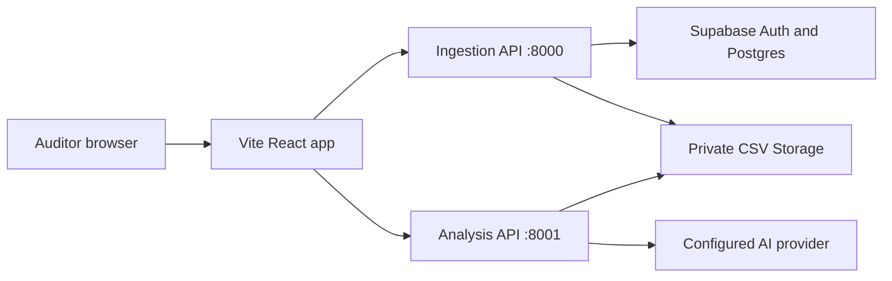

# BudgetClear

BudgetClear is a forensic review workspace for government spending data. Auditors upload CSV ledgers, run deterministic data checks, and review AI-assisted anomaly flags with links back to the exact source records. A balanced total alone cannot establish that every transaction is appropriate; BudgetClear helps identify records that deserve further investigation.

> **Audit interpretation:** A flag and its confidence score are review signals, not evidence of fraud or wrongdoing. An auditor must verify the source records and context before reaching a conclusion.

## What the application does

- **Auditor accounts:** Email and password sign-in through Supabase Auth, with account-specific audit history. Local SQLite mode is also available for development.
- **CSV ingestion:** Drag-and-drop or browse for one or more CSVs. Files are staged in the browser, then uploaded when **Run ingestion & checks** is pressed.
- **Deterministic pre-flight checks:** Validate required columns and fields, numeric amounts, supported currencies, and the project-specific DWP adjustment rule before analysis.
- **Anomaly detection:** Use sentence embeddings and FAISS for category outliers, Benford mean absolute deviation for eligible ledgers, and fuzzy invoice matching for possible duplicate billing.
- **Explanations and evidence:** Each new flag includes a detector score, score basis, short reason, supporting CSV record IDs, and a link to download the original file. When configured, an external AI model writes a concise explanation from the supplied evidence. A labeled detector explanation remains available if the AI provider cannot respond.
- **Persistent reports:** Save report snapshots and original CSV files under the signed-in auditor's account. Reopen and download prior reports from **Audit history**.

The report calls these values **confidence scores** in the interface. They are 0–100 measures of detector signal strength, **not calibrated probabilities of fraud**. The model does not set or change the scores.

## Stack and architecture

| Area | Implementation |
| --- | --- |
| Web application | React, TypeScript, Vite, React Router, Lucide icons, CSS |
| Ingestion and account API | FastAPI, pandas, Python multipart uploads |
| Analysis API | FastAPI, Sentence Transformers, FAISS, recordlinkage |
| AI explanations | Configurable OpenAI-compatible Chat Completions endpoint |
| Cloud persistence | Supabase Auth, Postgres, private Storage, row-level security |
| Local persistence | SQLite for accounts/reports and a local upload directory |



Vite proxies requests to the two APIs in local development and preview. A production host needs equivalent `/api/v1/*` routing. The AI key and Supabase key are read by the backend from its `.env` file; they are not placed in the frontend bundle.

## Repository structure

```text
BudgetClear/
├── README.md                         # This GitHub guide
└── VORTEXA 3.0/
    ├── Backend/
    │   ├── main.py                   # Login, ingestion, sources, reports API (:8000)
    │   ├── analyze.py                # Anomaly analysis API (:8001)
    │   ├── ai_explanations.py        # Short cited explanations and fallback
    │   ├── services.py               # Local/Supabase storage selection
    │   ├── supabase_store.py         # Supabase Auth, PostgREST, Storage requests
    │   ├── ledger_import.py          # Canonical and DWP CSV import
    │   ├── supabase/schema.sql       # Tables, private bucket, access policies
    │   ├── .env.example              # Configuration template; no real keys
    │   ├── requirements.txt
    │   └── tests/test_integrations.py
    └── Frontend/
        ├── src/                     # React components and styles
        ├── public/                  # Static assets and bundled DWP CSV
        ├── vite.config.js           # API proxy settings
        └── package.json
```

The project itself is in the `VORTEXA 3.0` subfolder. Run the backend and frontend commands from their respective folders, rather than from the Git repository root.

## Prerequisites

- Python and `pip` with support for the packages in `Backend/requirements.txt`.
- Node.js and `pnpm`.
- A Supabase project for cloud accounts, CSV storage, and reports. You can use local SQLite mode while setting up Supabase.
- An API key and model name from a provider that supports OpenAI-compatible Chat Completions with JSON mode **if** you want generated explanations. Detector explanations work without this key.
- Network access on first semantic analysis if `all-MiniLM-L6-v2` is not already cached.

## Configuration

Clone the existing GitHub repository, then use PowerShell from its root:

```powershell
git clone https://github.com/ShutReptile990/BudgetClear.git
cd BudgetClear
```

Create your private backend environment file:

```powershell
cd "VORTEXA 3.0\Backend"
Copy-Item .env.example .env
```

Edit `Backend/.env` and select one storage mode:

### Supabase mode

1. In your Supabase project, open **SQL Editor** and run the complete [`schema.sql`](VORTEXA%203.0/Backend/supabase/schema.sql). It creates the `public.csv_uploads` and `public.audits` tables, the private `budgetclear-csv` bucket, and their access policies.
2. Enable email/password authentication. For preview, set the Supabase Auth site URL to `http://127.0.0.1:4173`; add your real application URL when deploying. If email confirmation is enabled, confirm the address before signing in.
3. Set these values in `Backend/.env`:

   ```dotenv
   BUDGETCLEAR_STORAGE_BACKEND=supabase
   SUPABASE_URL=https://YOUR-PROJECT.supabase.co
   SUPABASE_ANON_KEY=YOUR_ANON_OR_PUBLISHABLE_KEY
   SUPABASE_CSV_BUCKET=budgetclear-csv
   ```

The backend uses each auditor's authenticated Supabase session when accessing Postgres or Storage. The SQL policies limit each account to its own audit rows and CSV folder. **Do not put a service-role key in the frontend or commit any real key to Git.** The actual `.env` file is Git-ignored.

### Local mode

For local development without a Supabase project, set:

```dotenv
BUDGETCLEAR_STORAGE_BACKEND=local
```

This uses `Backend/budgetclear.sqlite3` for accounts and reports and `Backend/uploads/<user-id>/` for original CSVs. Both are ignored by Git. Existing local accounts and reports are **not** automatically migrated to Supabase when you switch modes.

### AI explanations

To enable generated explanations, set all three values in the same backend `.env`:

```dotenv
AI_BASE_URL=https://api.openai.com/v1
AI_API_KEY=YOUR_PROVIDER_KEY
AI_MODEL=YOUR_AVAILABLE_MODEL_ID
```

`AI_BASE_URL` should end before `/chat/completions`. The provider and model must support JSON mode. Transaction descriptions, vendor names, amounts, and the supporting record samples for flagged transactions are sent to that provider. If these values are empty or the provider returns an error, flags still show their detector explanations and source evidence.

The `.env.example` also documents `BUDGETCLEAR_COOKIE_SECURE`, file and row limits, and AI timeout/flag limits. Use `BUDGETCLEAR_COOKIE_SECURE=1` when serving over HTTPS. Restart **both** FastAPI processes after editing `.env`.

For the full cloud setup procedure, see [AI and Supabase setup](VORTEXA%203.0/Backend/INTEGRATION_SETUP.md).

## Run on Windows

Open **three separate PowerShell terminals**. The paths below start at the cloned repository root.

**Terminal 1 — install backend dependencies and start ingestion/account API**

```powershell
cd "VORTEXA 3.0\Backend"
python -m venv .venv
.\.venv\Scripts\python.exe -m pip install -r requirements.txt
.\.venv\Scripts\python.exe -m uvicorn main:app --reload --host 127.0.0.1 --port 8000
```

**Terminal 2 — start analysis API**

```powershell
cd "VORTEXA 3.0\Backend"
.\.venv\Scripts\python.exe -m uvicorn analyze:app --reload --host 127.0.0.1 --port 8001
```

**Terminal 3 — install frontend dependencies, build, and preview**

```powershell
cd "VORTEXA 3.0\Frontend"
pnpm install
pnpm build
pnpm preview --host 127.0.0.1 --port 4173 --strictPort
```

Open **http://127.0.0.1:4173** in a browser even if `pnpm preview` does not print a clickable link. For active frontend development, use `pnpm dev` and open the URL Vite prints (normally `http://127.0.0.1:5173`). If you use email confirmation with the development URL, configure that URL in Supabase Auth as well.

API documentation is available at `http://127.0.0.1:8000/docs` and `http://127.0.0.1:8001/docs` while both servers run.

## Try an audit

1. Create an auditor account or sign in. In Supabase mode, confirm your email first if that project requires confirmation.
2. Open **New audit**, choose or drag one or more CSV files, and check the staged filenames and row counts.
3. Click **Run ingestion & checks**. This uploads the original files, validates them, reloads them for analysis, and saves the completed report.
4. In the report, filter the review queue and open a transaction or **View evidence**. The drawer shows the score basis, a short reason, cited records, and the original CSV download.
5. Open **Audit history** to revisit or download the stored report.

### CSV formats

Standard ledgers need a header row with these columns:

```csv
transaction_id,date,vendor,category,description,amount,invoice_number
TX-001,2026-04-01,Example Supplier,Office Supplies,Printer paper,2500.00,INV-001
```

An optional `currency` column can use `USD` or `GBP`. Run different currencies as separate audits. Standard ledger invoice numbers are required for deterministic pre-flight validation. Keep dates in `YYYY-MM-DD` format and amounts numeric.

The importer also recognizes DWP expenditure disclosures with `Date`, `Vendor`, `Invoice Cost Centre Description`, `Description`, `Transparency Invoice Amount`, and `Payment Number`. It accepts Windows-1252 encoding and negative adjustment lines. The previously supplied April 2026 file remains in `Frontend/public/` for reference; upload it through the normal file picker. Since that published dataset is selected by a £25,000 reporting threshold and has no invoice numbers, Benford and fuzzy invoice checks are skipped for it.

By default, a file can be up to **20 MB**, an audit can contain up to **50 files** and **50,000 records**, and AI explanations are attempted for up to **500 flags**. See `.env.example` for configurable limits. If you increase the CSV size limit in `.env`, also raise the private bucket limit in Supabase.

## How findings and evidence are stored

1. The ingestion API reads and validates the uploaded file, computes its SHA-256 hash, and stores the **original CSV bytes** in private Storage or the local uploads directory.
2. Each parsed record gets an evidence ID based on the source UUID and its data-record number. The number counts CSV records after the header, not physical lines in a file with multiline quoted fields.
3. The analysis API reloads the stored source and checks its hash before computing anomaly scores. The explanation service can cite only evidence IDs provided by the detectors; unsupported or malformed AI output falls back to the detector reason.
4. The account API saves a report snapshot containing the normalized transactions, findings, scores, explanations, cited evidence, source IDs, and snapshot SHA-256. In Supabase mode, metadata and reports are in Postgres while the raw CSV is in the private bucket.

The existing checks validate required data and amounts. **The application does not currently parse Excel formulas, prove that a CSV was truncated, or reconcile category totals against external declared totals.** A completed report should not be read as a certification that those checks passed.

## API routes

| Service | Route | Purpose |
| --- | --- | --- |
| Ingestion `:8000` | `POST /api/v1/auth/signup`, `/login`, `/logout` | Account actions |
| Ingestion `:8000` | `GET /api/v1/auth/me` | Current auditor |
| Ingestion `:8000` | `POST /api/v1/ingest` | Validate and preserve an uploaded CSV |
| Ingestion `:8000` | `GET /api/v1/sources/{source_id}/download` | Download the owner's original CSV |
| Ingestion `:8000` | `GET/POST /api/v1/audits` | List or save reports |
| Ingestion `:8000` | `GET /api/v1/audits/{audit_id}` | Open a report |
| Analysis `:8001` | `POST /api/v1/analyze` | Analyze previously uploaded source IDs |

Authenticated requests use HttpOnly session cookies through the frontend proxy. The backend checks ownership before returning stored evidence or reports.

## Troubleshooting

- **`pnpm preview` shows no link:** Run `pnpm build` first, leave the preview terminal open, and enter `http://127.0.0.1:4173` directly. The `--strictPort` command above reports a conflict if port 4173 is occupied.
- **`PGRST205` or “table is missing”:** Run the **entire** `Backend/supabase/schema.sql` in the SQL Editor of the project named by your `SUPABASE_URL`. Confirm that `public.csv_uploads` and `public.audits` appear in Table Editor.
- **Supabase bucket or permission error:** Confirm that the private bucket is named `budgetclear-csv`, the bucket name matches `SUPABASE_CSV_BUCKET`, the SQL policies were created, and you are signed in to a Supabase account. See [Supabase Storage access control](https://supabase.com/docs/guides/storage/security/access-control).
- **AI endpoint returns HTTP 429:** Check the AI provider's quota, billing, or rate limits. The report labels the detector explanation as a fallback until the provider accepts requests.
- **First analysis is slow:** The sentence embedding model may need to download and cache on its first use.
- **Changes to `.env` seem ignored:** Restart both backend processes. Environment variables already set in your shell override `.env` values.

## Checks

From `VORTEXA 3.0/Backend`, run the offline integration checks:

```powershell
.\.venv\Scripts\python.exe -m unittest discover -s tests -v
```

From `VORTEXA 3.0/Frontend`, check TypeScript and the production bundle:

```powershell
pnpm build
```

These checks use mocked external responses. A live Supabase project still needs the SQL setup, and live AI availability depends on your chosen provider and account.

## Further reading

- [Backend setup and integration details](VORTEXA%203.0/Backend/INTEGRATION_SETUP.md)
- [Frontend setup](VORTEXA%203.0/Frontend/README.md)
- [Supabase password authentication](https://supabase.com/docs/guides/auth/passwords)
- [Supabase Storage access control](https://supabase.com/docs/guides/storage/security/access-control)
- [OpenAI Chat Completions API](https://developers.openai.com/api/reference/resources/chat/subresources/completions/methods/create)
